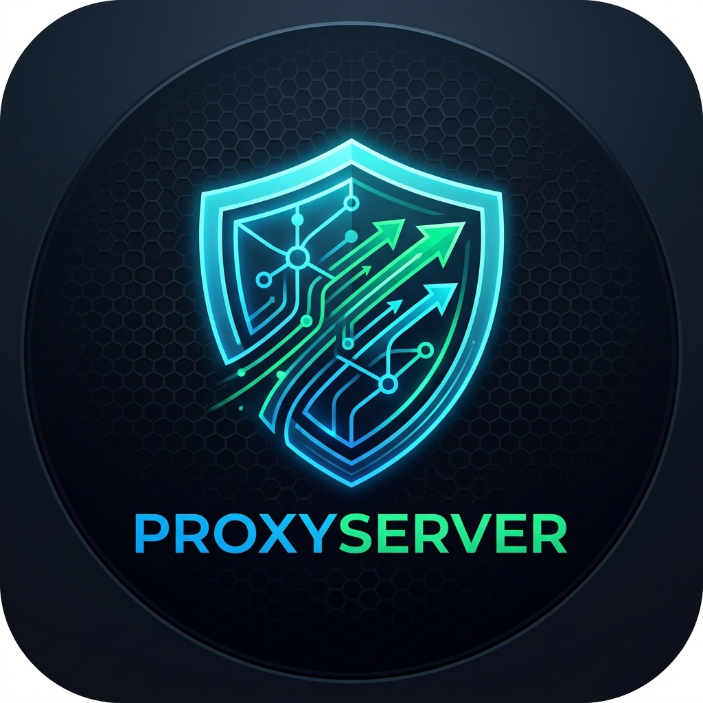

<p align="center">
  
</p>

# ProxyServer Gateway & Cloudflare DDNS Manager

A unified, high-performance reverse proxy server and automated Cloudflare Dynamic DNS manager written in **Go**, featuring a modern **React (Vite + TypeScript)** dark mode web interface with full authentication and security.

Combines and replaces legacy reverse proxies and standalone containers like `oznu/docker-cloudflare-ddns` into a single standalone gateway with **zero-downtime dynamic routing**. Built with an **Alpine Linux** container image and direct **Unraid template** support.

---

## 🌟 Key Features

### 🚀 High-Performance Dynamic Reverse Proxy (Go)
- **Zero-Downtime Route Management**: Add, edit, remove, enable, or disable proxy targets via the Web UI or REST API without restarting the server.
- **Automated TLS / HTTPS**:
  - Built-in **Let's Encrypt ACME Autocert** integration with dynamic host policy that automatically provisions SSL certificates for newly added domains on the fly.
  - Support for custom certificates and keys.
  - Support for Cloudflare Origin CA / Full SSL mode and self-signed development certificates.
- **Force SSL**: One-click HTTP-to-HTTPS redirect per proxy target.
- **Gateway Authentication Guard**: Route-level protection requiring login before forwarding to internal services.
- **WebSocket & HTTP/2 Support**: Built on Go's battle-tested standard library reverse proxy with streaming and connection hijacking support.
- **Upstream Health Monitoring**: Background probes continuously check target health and measure response latency (ms).
- **Live Connection Probing**: Test target reachability directly from the UI before saving.

### 🌐 Native Cloudflare Dynamic DNS (DDNS)
- **Unified Replacement for `oznu/docker-cloudflare-ddns`**: Eliminates the need to run a separate DDNS container.
- **Multi-Source Public IP Resolution**: Automatically determines your external IP with failover across `api.ipify.org`, `1.1.1.1/cdn-cgi/trace`, `icanhazip.com`, and `checkip.amazonaws.com`.
- **Automatic DNS Record Synchronization**: Automatically creates or updates Cloudflare `A` records whenever public IP changes.
- **Auto-Sync Proxy Domains**: When enabled, newly registered reverse proxy domains are immediately synchronized with Cloudflare DNS.
- **Cloudflare Orange Cloud Support**: Configurable Cloudflare proxying (CDN/WAF) or DNS-only mode.
- **API Token Verification & Zone Discovery**: Discover and select active zones directly inside the UI.

### 💻 Modern Dark Mode Web Management UI (React)
- **Glassmorphic Aesthetic**: Curated dark palette (`#080c14`, `#0d1322`, cyan/emerald accents) with micro-animations and glowing status indicators.
- **Comprehensive Dashboard**: Real-time traffic metrics, healthy vs unhealthy upstream counts, and public IP monitor.
- **Live Access Log Stream**: Server-Sent Events (SSE) streaming real-time request paths, response codes, latencies, and source IPs.
- **Single-Binary Distribution**: The compiled React SPA is embedded directly into the Go executable via `//go:embed`.

### 🛡️ Security & Access Control
- **Administrator Setup & Authentication**: First-time setup wizard with bcrypt password hashing and signed JWT sessions (HTTP-only cookies and Bearer tokens).
- **Brute-Force Rate Limiting**: Sliding-window rate limiter on authentication endpoints.
- **Security Headers**: Standard protection headers (`X-Content-Type-Options: nosniff`, `X-Frame-Options: SAMEORIGIN`, CSP, and CORS for development).
- **Protected Gateway Routes**: End-user login screen with session cookies for private subdomains.

---

## 🏛 Architecture

```
                  ┌──────────────────────────────────────────────┐
                  │                 Internet                     │
                  └──────────────┬───────────────────────────────┘
                                 │
           ┌─────────────────────┴─────────────────────┐
           │                                           │
    HTTP (Port 9080)                            HTTPS (Port 9443)
  ACME Challenge / SSL Redirect             Let's Encrypt TLS Termination
           │                                           │
           └─────────────────────┬─────────────────────┘
                                 ▼
                     ┌───────────────────────┐
                     │   Proxy Engine (Go)   │
                     │  Dynamic Route Table  │
                     └───────────┬───────────┘
                                 │
                 ┌───────────────┼───────────────┐
                 ▼               ▼               ▼
           movies.home...  local.home...   custom.domain...
           (192.168.1.104)   (127.0.0.1)     (192.168.1.50)

───────────────────────────────────────────────────────────────────

   Management Web UI & REST API (:8080)
   ┌───────────────────────────────────────────────────────────────┐
   │ React SPA (Embedded) • Admin Auth • DDNS Control • Live Logs  │
   └───────────────────────────────┬───────────────────────────────┘
                                   │
                      ┌────────────┴────────────┐
                      ▼                         ▼
            Cloudflare DDNS Engine      Config Store (Atomic JSON)
            Auto-Sync A-Records         data/config.json
```

---

## ⚡ Quick Start

### 1. Run on Unraid (Alpine Docker Container)

ProxyServer includes a native Unraid template XML and Alpine container configured with `nobody:users` (`PUID=99`, `PGID=100`) permissions:

1. Copy the template to your Unraid flash drive:
   ```bash
   curl -sSL https://raw.githubusercontent.com/sebmak/ProxyServer/main/unraid/ProxyServer.xml \
     -o /boot/config/plugins/dockerMan/templates-user/my-ProxyServer.xml
   ```
2. In the Unraid WebGUI, navigate to **Docker -> Add Container**.
3. Select **ProxyServer** from the Template dropdown.
4. Verify port mappings (`8080`, `9080`, `9443`) and storage path (`/mnt/user/appdata/proxyserver`).
5. Click **Apply**!

Detailed guide: [unraid/README.md](unraid/README.md).

### 2. Run with Docker Compose

```bash
docker compose up -d
```

Access the Web UI at **http://localhost:8080**.

### 2. Run Locally from Source

#### Prerequisites
- Go 1.22+
- Node.js 18+ and npm

#### Build and Run
```bash
# 1. Build the frontend
cd web && npm install && npm run build && cd ..

# 2. Build and run the server
go build -o ./bin/proxyserver ./cmd/proxyserver
./bin/proxyserver
```

Navigate to **http://localhost:8080** to complete the first-time administrator setup!

---

## 🔄 Legacy Migration (`servers.json`)

If you have an existing configuration from a legacy proxy server, you can import it seamlessly without restarting:

1. **During Initial Setup**: When visiting the Web UI (`http://localhost:8080`) for the first time, click **"Import Existing servers.json (Optional)"** and paste your JSON payload. All your proxy routes will be configured instantly alongside your new admin credentials.
2. **From Settings Anytime**: In **Settings -> Configuration & Legacy Import**, click **"Paste & Import Legacy servers.json"** to import routes into your live configuration.

---

## ⚙️ Configuration & Environment Variables

| Variable | Default | Description |
|---|---|---|
| `ADMIN_PORT` | `8080` | Port for Web Management UI and Admin REST API |
| `HTTP_PORT` | `9080` | Port for HTTP reverse proxy traffic and ACME challenges |
| `HTTPS_PORT` | `9443` | Port for HTTPS reverse proxy traffic with TLS |
| `DATA_DIR` | `./data` | Directory for persistent storage (`config.json`, certs) |
| `CONFIG_PATH` | `/data/config.json` | Path to persistent configuration file |
| `CERT_DIR` | `/data/certs` | Directory for ACME certificate cache |

---

## ☁️ Cloudflare Dynamic DNS Setup

1. In Cloudflare, navigate to **My Profile -> API Tokens -> Create Token**.
2. Use the **Edit zone DNS** template or create a custom token with:
   - **Permissions**: `Zone.DNS` (Edit), `Zone.Zone` (Read)
   - **Zone Resources**: Include all zones or select your specific zone (e.g., `makinson.me`).
3. Open the **Cloudflare DDNS** tab in the ProxyServer Web UI.
4. Paste your API Token and click **Verify Token**.
5. Select your Zone, enable the toggle, and click **Save Cloudflare Settings**.
6. Click **Sync DNS Now** to perform an immediate sync!

---

## 🧪 Testing

Run all Go unit tests:
```bash
go test -v ./...
```

Run React build and linting:
```bash
cd web && npm run build
```

---

## 📄 License
MIT License.
